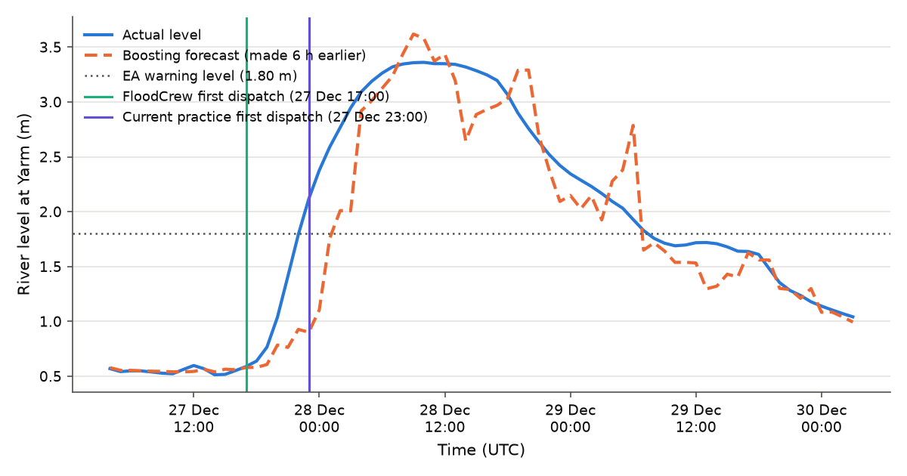
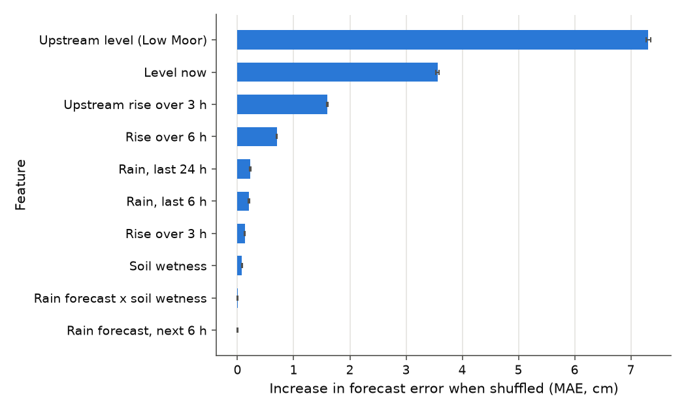

# FloodCrew: intelligent decision support for flood crew deployment

FloodCrew helps an emergency officer decide where to send a limited number of crews when the River Tees is rising.

| IDSS part | File | What it does |
|---|---|---|
| Data | `floodcrew/fetch_ea.py`, `floodcrew/synthetic.py` | Real Environment Agency river levels and rainfall (default), or a simulated Tees catchment |
| Model (ML) | `floodcrew/train.py` | Forecasts each gauge 6 hours ahead (ridge regression + gradient boosting), tested against persistence. The planner uses gradient boosting for every gauge (`PLANNER_MODEL` in `config.py`) |
| Knowledge base (rules) | `floodcrew/plan.py` | Flood probability per site, impact (homes, protected sites), approval rules |
| Optimisation | `floodcrew/plan.py` | Hungarian assignment of crews to sites (value protected minus travel time); crews left idle are sent to the next highest-risk uncovered sites (at least 1% flood chance) |
| Evaluation | `floodcrew/evaluate.py` | Replays every test storm: FloodCrew vs current practice |
| Snow & ice | `floodcrew/ice.py` | Real Middlesbrough weather (Open-Meteo), estimated road temperature, ice risk per route, gritter assignment, replay vs precautionary runs |
| Interface | `api.py` | FastAPI endpoints for forecast, plan and metrics |

The model is trained on the first 75% of the data (in time order) and tested on the last 25%, which it never sees during training.

## 1. Set up

```bash
cd python-ml
python -m venv .venv
source .venv/bin/activate          # Windows: .venv\Scripts\activate
pip install -r requirements.txt
```

## 2. Run on real data

```bash
python -m floodcrew.fetch_ea                 # download EA river levels + rainfall (2015-01-01 to today)
python -m floodcrew.train                    # train and test the 6-hour forecasts
python -m floodcrew.evaluate --crews 3       # replay every test-period storm: FloodCrew vs current practice
python -m floodcrew.ice --gritters 2         # snow & ice on real Middlesbrough weather
uvicorn api:app --reload                     # then open http://127.0.0.1:8000/docs
```

All results go to `models/metrics.json` (`gauges` from train, `evaluation` from evaluate, `ice` from ice).
The download takes a few minutes the first time; 15-minute readings are cached in `data/raw/` (not committed), so
re-runs are quick. Other ranges: `python -m floodcrew.fetch_ea download --start 2020-01-01 --end 2026-11-16`.
`python -m floodcrew.fetch_ea discover` lists the Tees gauges and nearby rain gauges.

To run offline on simulated data instead: `--data synthetic` for train/evaluate and `--weather synthetic` for ice.

## 3. Real data sources

| Data | Source | Detail |
|---|---|---|
| River levels | Environment Agency **Hydrology API** (`environment.data.gov.uk/hydrology`) | Quality-checked 15-minute level, hourly mean. Broken Scar `F3501`, Low Moor `F3606`, Yarm `L3602`, Stockton `L3907`. Readings flagged Suspect/Missing/Rejected are dropped, then readings outside each gauge's plausible range (EA record low − 0.1 m to record high + 0.5 m, `PLAUSIBLE` in `config.py`) and single-reading spikes more than 0.5 m from both neighbours. On the 2015–2026 data this removed 3 spikes (1 at Yarm, 2 at Stockton) and nothing outside the ranges. Gaps up to 6 hours are interpolated. |
| Newest readings | Environment Agency **real-time flood-monitoring API** (`environment.data.gov.uk/flood-monitoring`) | Only keeps about the last 28 days, so it tops up readings the Hydrology service has not published yet. |
| Rainfall | EA Hydrology API, 15-minute rain gauges | Up to 6 nearest gauges within 25 km of Yarm with at least 60% hourly coverage, averaged each hour (currently Darlington Lingfield Way, East Cowton, Harpington Hill Farm, Low Moor Farm, Middlesbrough Stewart Park, Romanby). |
| Winter weather | **Open-Meteo historical weather API** (`archive-api.open-meteo.com`, free, no key) | Hourly air temperature, dew point, precipitation and cloud cover for Middlesbrough, winters 2024/25 and 2025/26 (1 Nov to 31 Mar), cached in `data/middlesbrough_weather.csv`. |

Files: `data/tees_hourly.csv` (columns: time, broken, lowmoor, yarm, stockton, rain; levels in metres, rain in mm)
and `data/middlesbrough_weather.csv`.

Notes:
- **Warning levels are the official EA flood alert levels** ("top of normal range: low-lying land flooding possible, one or more flood alerts may be issued"), from the flood-monitoring API (`typicalRangeHigh`) and gov.uk Check for Flooding: Broken Scar 2.50 m, Low Moor 4.50 m, Yarm 1.80 m, Stockton 3.20 m. They are set as `ea_alert` in `config.py`. The EA's "property flooding possible" levels (3.10, 6.50, 5.37 and 3.70 m) are kept as `ea_property` for reference; in 2015–2026 only Broken Scar passed its level (8 hours, Dec 2015 and Feb 2020), too rare to train or test warnings on. Simulated data keeps its own levels (the level exceeded 0.7% of the time).
- Stockton sits above the Tees Barrage, which holds the river level steady, so it barely responds to rain (about 6.5 cm standard deviation). Its forecasts and warnings are weak for that reason, not because of missing data.
- `rain_fc_6h` uses the rain that actually fell, with about ±40% random error to mimic a forecast. In live use, replace it with a real rainfall forecast (for example Open-Meteo).
- **Road temperature is estimated**, not measured: it follows the real air temperature with a lag, plus each route's offset and the effect of clear skies at night and in daytime sun (`estimate_road` in `ice.py`). The 6-hour air temperature and cloud forecasts are the observed values plus noise. If the council can share road sensor temperatures, use them as the target instead.

Attribution: this uses Environment Agency flood and river level data from the real-time data API (Beta) and the
Hydrology data service, Open Government Licence. Weather data by Open-Meteo.com (CC BY 4.0).

## 4. Results on real data (11.9 years, 2015-01-02 to 2026-11-16; test period 28 Nov 2023 to 16 Nov 2026)

All of these are stored in `models/metrics.json`: `gauges` (train), `evaluation_runs[protected weight][crews]` and
`evaluation` (3 crews, weight 2.0) from evaluate, `ice_by_gritters[n]` and `ice` (2 gritters) from ice.
Run order: `train`, then `evaluate` and `ice` (train rewrites the file).

### Forecast accuracy (6 hours ahead)

| Gauge | Warning threshold | Hours above it (test) | MAE ridge | MAE boosting | MAE persistence | Recall ridge | Recall boosting | Recall persistence | Planner uses |
|---|---|---|---|---|---|---|---|---|---|
| Broken Scar | 2.50 m, official EA | 15 | 3.74 cm | 3.24 cm | 3.90 cm | 0% | 0% | 0% | boosting |
| Low Moor | 4.50 m, official EA | 68 | 7.25 cm | 2.43 cm | 8.21 cm | 48.5% | 85.3% | 45.6% | boosting |
| Yarm | 1.80 m, official EA | 222 | 3.66 cm | 3.12 cm | 4.40 cm | 68.0% | 61.7% | 55.9% | boosting |
| Stockton | 3.20 m, official EA | 10 | 2.03 cm | 1.78 cm | 2.18 cm | 0% | 0% | 0% | boosting |

Recall is reported as "no warning events" for any gauge that never reaches its threshold in the test period
(none at present).

### Crew deployment (all 18 test-period storms; FloodCrew vs current practice)

Site flood levels are the gauge's EA alert level plus the site offset in `config.py`; no site floods at the alert level
itself, and current practice dispatches at the alert level. Use `--max-storms N` to replay only the first N storms.

| Protected weight | Crews | Protected sites covered: FloodCrew | Current practice | All flooded sites covered: FloodCrew | Current practice |
|---|---|---|---|---|---|
| 1.5 | 2 | 11/13 (85%) | 9/13 (69%) | 22/42 (52%) | 25/42 (60%) |
| 1.5 | 3 | 11/13 (85%) | 10/13 (77%) | 34/42 (81%) | 30/42 (71%) |
| 1.5 | 5 | 11/13 (85%) | 10/13 (77%) | 35/42 (83%) | 31/42 (74%) |
| 2.0 | 2 | 11/13 (85%) | 9/13 (69%) | 22/42 (52%) | 25/42 (60%) |
| 2.0 | 3 | 12/13 (92%) | 10/13 (77%) | 30/42 (71%) | 30/42 (71%) |
| 2.0 | 5 | 12/13 (92%) | 10/13 (77%) | 36/42 (86%) | 31/42 (74%) |

### Snow and ice (last 25% of winter 2025/26; FloodCrew vs precautionary runs)

| Gritters | Ice events gritted in time | Hospital route + school road in time | Gritting runs |
|---|---|---|---|
| 1 | 9/17 (53%) vs 3/17 (18%) | 5/10 vs 2/10 | 28 vs 52 |
| 2 | 9/17 (53%) vs 6/17 (35%) | 5/10 vs 5/10 | 36 vs 52 |
| 3 | 10/17 (59%) vs 9/17 (53%) | 6/10 vs 8/10 | 39 vs 52 |

Road temperature 6 h ahead: MAE 0.84 °C (persistence 1.92 °C), the same for every gritter count.

### Figures

`python -m floodcrew.figures` (after `train`) writes two figures to `docs/figures/`:

- `yarm_storm.png`: the largest test-period storm at Yarm (peak 3.36 m, 28 Dec 2023): actual level, the boosting
  6-hour forecast plotted at the hour it is for, the EA warning level, and the first crew dispatch (3 crews, weight 2.0).
  FloodCrew sent its first crew at 17:00 on 27 Dec, 6 hours before current practice (23:00).
- `importance.png`: permutation importance of the Yarm boosting model on the test period (rise in MAE when a feature
  is shuffled). The upstream level at Low Moor matters most (+7.3 cm), then the current level (+3.6 cm).




## 5. What to report

- **Forecast accuracy:** MAE, R², and warning precision/recall for ridge, gradient boosting and persistence (`models/metrics.json`).
- **Decision quality:** sites and protected sites covered in time, FloodCrew vs current practice, for 2, 3 and 5 crews.
- **Trade-offs:** with few crews, FloodCrew puts protected sites first (care home, school, hospital route), so it may cover fewer sites in total. That comes from the protected-site weight, and you can change it.
- **Simon's model:** Intelligence (forecast, risk), Design (optimiser, what-if), Choice (officer approval), Review (evaluation).
